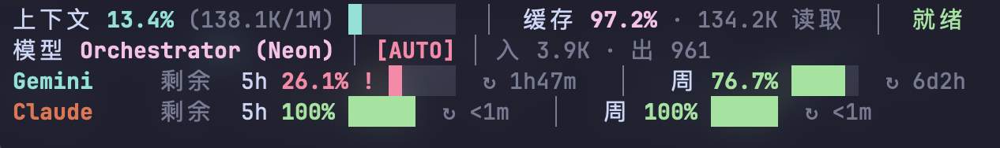

# agy-statusline-pro

零依赖的 Antigravity CLI (`agy`) 增强状态栏插件。实时展示精确上下文 Token 用量、当前设置模型与实际底层子模型（如 Orchestrator 下的 Neon / Hydrogen 切换）、缓存健康度与按需告警提示。

## 实际效果

日常运行效果（含实际模型与切换轨迹）：



开启 Orchestrator 自动调度且触发完整告警提示时的效果：


## 核心特性

- **精确上下文 Token 与阈值提示**：同时显示百分比与具体 Token 数（如 `13.4% (138.1K/1M)`），上下文超过 `200K` 或达到 `≥75%` 时自动高亮 `>200K` / `建议/compact`。
- **当前工作目录展示**：在首行醒目展示当前完整工作目录路径（主目录自动缩写为 `~`，仅在窄终端下依次降级为 `…/上级目录/当前目录` 或目录名），多窗口切换一目了然。
- **实时追踪实际调用模型**：当使用 `Orchestrator` 等复合模式时，轻量读取当前会话 `transcript.jsonl` 尾部，实时展示设置模型与实际底层模型（`Orchestrator (Neon) → 实际 Hydrogen (High)`）及近期切换轨迹（`轨迹 Neon×7→Hydrogen×4`）。
- **缓存命中与重建提示**：兼容 Antigravity CLI 1.5.x+ 缓存统计，在缓存冷启动或重建时提示 `缓存重建` / `+写入`。
- **按需友好提示（未触发时零干扰）**：
  - `[! 待确认]`：等待工具授权时醒目提醒
  - `[PLAN]` / `[AUTO]` / `[ACCEPT-EDITS]`：当前交互模式标签
  - `子代理 N · 后台 M · 排队 K`：运行中的子代理、后台任务和排队消息数
  - `[沙箱]`：终端沙箱开启标记
  - `[NORMAL]` / `[INSERT]`：Vim 编辑模式状态
  - `$0.42`：会话预估费用（CLI 上报时显示）
- **逐条消息明细查询 (`--history`)**：按步骤输出当前或指定会话中每条响应实际使用的模型、输入、缓存命中率、输出和工具调用统计。
- **终端宽度自适应**：按优先级自动折叠次要标签，在窄终端下也不会折行错位。

## 快速安装

环境要求：**Node.js >= 20**，零外部依赖，支持 macOS / Linux / Windows。

### 方式一：通过 `npx` 一键安装（推荐）

```bash
npx github:HoloXia/agy-statusline-pro
```

可选参数：

```bash
# 指定语言（zh-CN / zh-TW / en）或额外显示累计 Token 行
npx github:HoloXia/agy-statusline-pro -- --language zh-CN --details
```

### 方式二：从源码安装

```bash
git clone https://github.com/HoloXia/agy-statusline-pro.git
cd agy-statusline-pro
node install.mjs --language zh-CN
```

> 安装脚本会自动备份你原有的 `statusLine` 配置到 `~/.gemini/antigravity-cli/.agy-statusline-pro-backup.json`，不会影响 `settings.json` 中的其他设置。
> 安装后重启 `agy` 即可自动生效；若希望在已打开的会话中立即启用，可在会话内执行 `/statusline enable`。

## 常用命令

```bash
# 预览单模型状态栏效果
node ~/.gemini/antigravity-cli/agy-statusline-pro/statusline.mjs --preview

# 预览 Orchestrator 模式 + 完整告警效果
node ~/.gemini/antigravity-cli/agy-statusline-pro/statusline.mjs --preview-orchestrator

# 查看最近一次会话逐条消息的模型与 Token 明细
node ~/.gemini/antigravity-cli/agy-statusline-pro/statusline.mjs --history

# 查看指定 transcript.jsonl 的明细
node ~/.gemini/antigravity-cli/agy-statusline-pro/statusline.mjs --history /path/to/transcript.jsonl

# 卸载并恢复安装前的状态栏配置
node ~/.gemini/antigravity-cli/agy-statusline-pro/install.mjs --uninstall
```

## 致谢与协议

- 布局与配额分组设计灵感来自 [wycocoyu/agy-context-dashboard](https://github.com/wycocoyu/agy-context-dashboard)。
- 本项目基于 [MIT License](./LICENSE) 开源。
